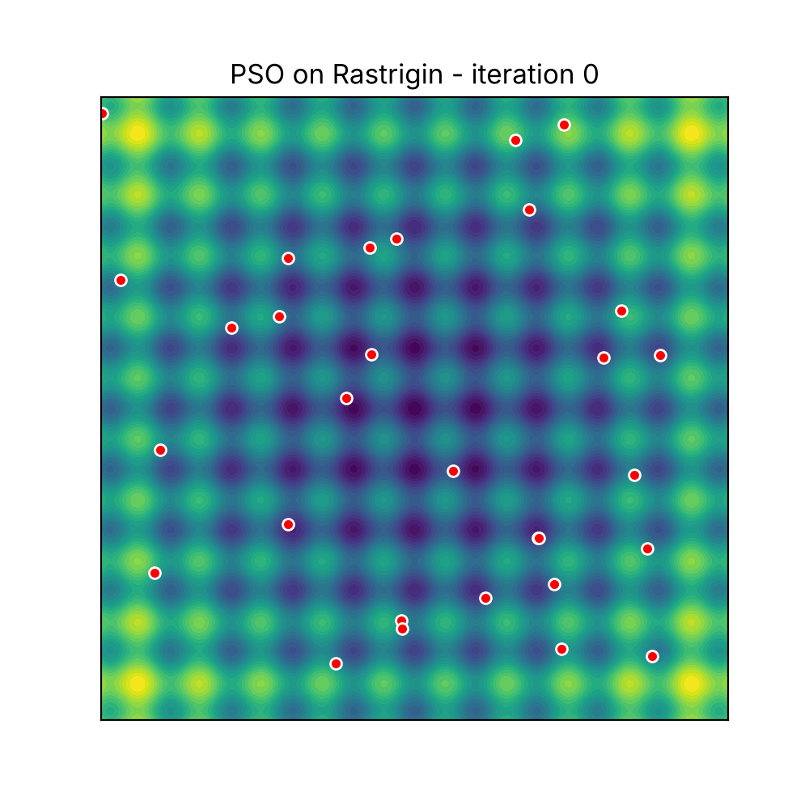
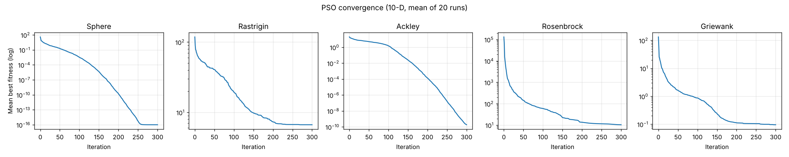
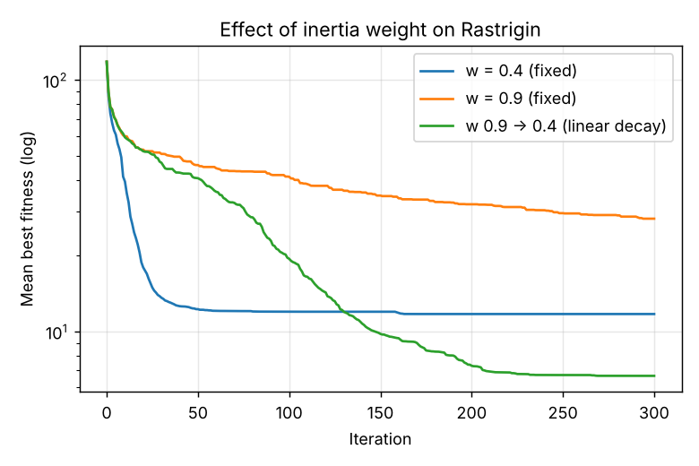
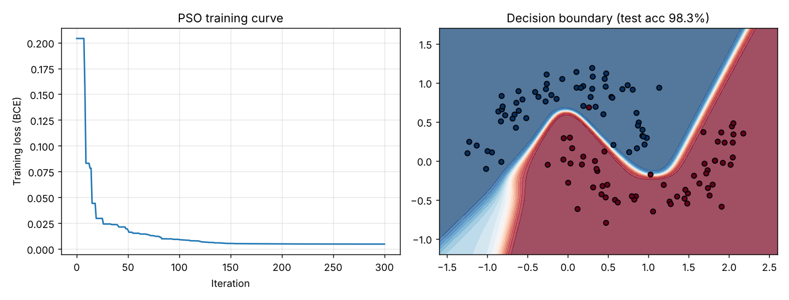

# Swarm Intelligence with Particle Swarm Optimization (PSO)

A clean, from-scratch **Particle Swarm Optimization** library in pure NumPy, built as a Soft Computing project. It includes benchmark experiments, a parameter study, and a practical application: **training a neural network without backpropagation**.



## What is PSO?

PSO is a swarm-intelligence algorithm inspired by bird flocking. A swarm of particles moves through the search space; each particle remembers its own best position (`pbest`) and is pulled toward the best position found by the whole swarm (`gbest`):

```
v = w * v + c1 * r1 * (pbest - x) + c2 * r2 * (gbest - x)
x = x + v
```

| Symbol | Meaning |
|---|---|
| `w` | inertia weight (exploration vs. exploitation) |
| `c1` | cognitive coefficient (trust in own memory) |
| `c2` | social coefficient (trust in the swarm) |
| `r1, r2` | random numbers in [0, 1] |

## Features

- Vectorised PSO implementation (`pso/optimizer.py`) with linearly decreasing inertia weight, velocity clamping, boundary handling and seeding
- 5 benchmark functions: Sphere, Rastrigin, Ackley, Rosenbrock, Griewank
- Statistical evaluation over 20 independent runs
- Inertia-weight study
- Application: training a 2-8-1 neural network with PSO on the two-moons dataset
- Unit tests

## Project structure

```
swarm-pso/
├── pso/
│   ├── optimizer.py        # PSO class
│   └── benchmarks.py       # test functions
├── examples/
│   ├── benchmark_demo.py   # experiments, plots, GIF
│   └── neural_network_pso.py
├── tests/test_pso.py
├── assets/                 # generated plots
├── requirements.txt
└── LICENSE
```

## Quick start

```bash
git clone https://github.com/<your-username>/swarm-pso.git
cd swarm-pso
pip install -r requirements.txt

python examples/benchmark_demo.py
python examples/neural_network_pso.py
python tests/test_pso.py        # or: pytest
```

Use it in your own code:

```python
from pso import PSO
from pso.benchmarks import rastrigin

result = PSO(rastrigin, bounds=(-5.12, 5.12), dim=10, n_particles=40, seed=0).run(iters=300)
print(result.best_value, result.best_position)
```

## Results

### 1. Benchmark functions (10-D, 40 particles, 300 iterations, 20 runs)

| Function | Mean best | Std | Best run |
|---|---|---|---|
| Sphere | 9.15e-23 | 2.00e-22 | 1.67e-25 |
| Ackley | 1.83e-10 | 4.32e-10 | 8.87e-12 |
| Griewank | 9.56e-02 | 3.96e-02 | 3.51e-02 |
| Rosenbrock | 1.04e+01 | 1.79e+01 | 0.248 |
| Rastrigin | 6.67 | 2.46 | 1.99 |

PSO solves the smooth unimodal Sphere and Ackley almost perfectly. On highly multimodal Rastrigin and the narrow-valley Rosenbrock it often settles in a local optimum, which is the classic premature-convergence behaviour of PSO.



### 2. Effect of inertia weight

A linearly decaying inertia weight (0.9 to 0.4) explores widely at first and refines later, compared with fixed values.



### 3. Training a neural network with PSO (no gradients)

Each particle encodes all 33 weights of a 2-8-1 network; fitness is the binary cross-entropy loss.

| Metric | Value |
|---|---|
| Final training loss | 0.0047 |
| Train accuracy | 100% |
| Test accuracy | 98.3% |



## Possible extensions

- Compare against Genetic Algorithm or Differential Evolution
- Add other topologies (ring/local-best PSO) to reduce premature convergence
- Apply PSO to feature selection or hyperparameter tuning
- Constriction-factor PSO and adaptive parameters

## License

MIT. See [LICENSE](LICENSE). Replace `<YOUR NAME>` in the license file with your name.
